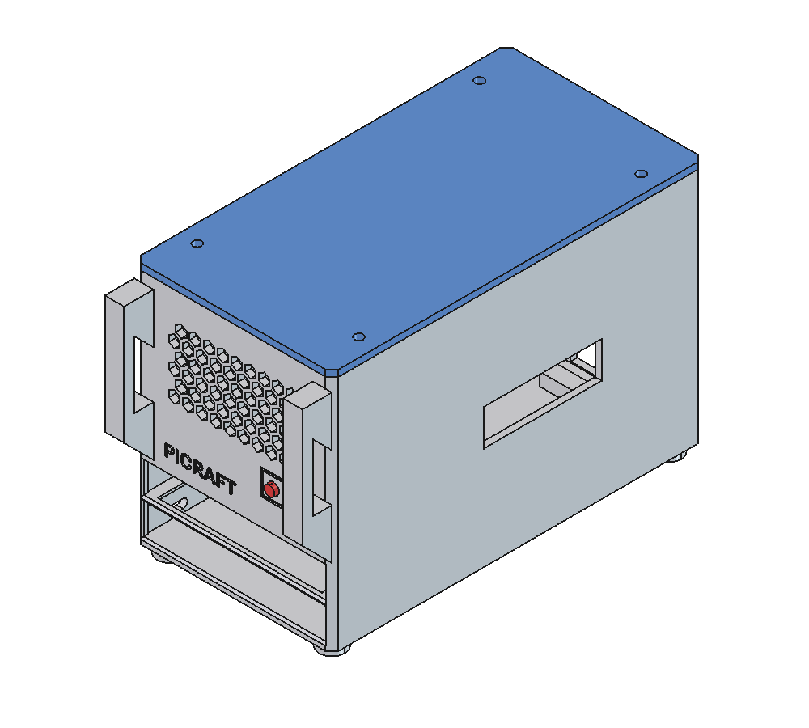
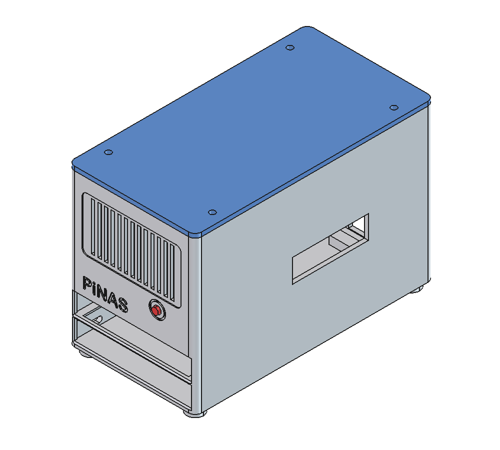
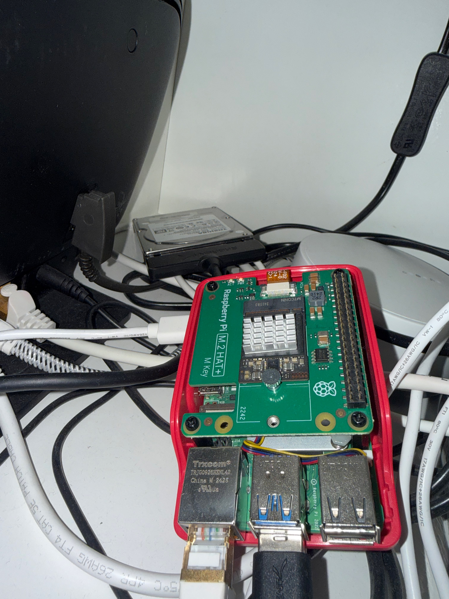

# PiCRAFT

3D-druckbares Server-Gehäuse für einen Raspberry Pi 5 mit M.2 HAT+ und zwei 2,5"-Laufwerken. Gedacht für Minecraft-Server, Backup und NAS.

**Aktuelle Version: 8**

**Außenmaße (Breite × Tiefe × Höhe):**

| Stil | Maße |
|---|---|
| Server (mit Griffen) | ca. 7,7 × 15,7 × 9,9 cm |
| NAS | ca. 7,7 × 14,5 × 9,9 cm |

Es gibt zwei Stil-Varianten mit identischem Innenleben. Nur Front, Außenkanten und Griffe unterscheiden sich. **Hauptstil ist Server**, NAS bleibt als Alternative.

| Server (`server`, Hauptstil) | NAS (`nas`) |
|---|---|
|  |  |



## Dateien

| Datei | Inhalt |
|---|---|
| `picraft_gehaeuse.py` | Bauskript. Alle Maße als Parameter oben. Erzeugt das Modell in FreeCAD komplett neu. |
| `PiCRAFT_Server.FCStd` | Gespeichertes FreeCAD-Modell, Stil Server (Dokument „PiCRAFT_Server“) |
| `PiCRAFT_NAS.FCStd` | Gespeichertes FreeCAD-Modell, Stil NAS (Dokument „PiCRAFT_NAS“) |
| `PiCRAFT_Server.blend` | Blender-Szene, Stil Server: die fünf STL-Dateien zusammengebaut in Einbaulage (Maße in Metern, 1 mm = 0,001 m). Nur zum Ansehen und Rendern, wird vom Skript nicht erzeugt. |
| `CLAUDE.md` | Arbeitsanweisungen für Claude Code |
| `ansicht.png` / `ansicht_server.png` | Gerenderte Ansichten beider Stile |
| `IMG_3338.jxl` / `.jpeg` | Foto des aktuellen Aufbaus (JPEG für die Anzeige auf GitHub) |

Modell neu erzeugen: In FreeCAD *Makro → Makros…* oder über Claude (FreeCAD-MCP) `picraft_gehaeuse.py` ausführen. Das Skript baut beide Stile; welche, steht in `STYLES` oben im Skript.

## Gehäuse

- **Außenmaß:** 77 × 145 × 99 mm (B × T × H, mit Deckel und Füßen); Server-Stil mit Griffen 77 × 156,5 × 99 mm
- **Innenmaß:** 72 × 140 × 90 mm, Wandstärke 2,5 mm
- **Außenkanten:** senkrechte Kanten von Gehäuse und Deckel mit 4 mm Radius (NAS) bzw. 2,5 mm Fase (Server), runde Füße

### Druckteile

| Teil | Beschreibung |
|---|---|
| Gehäuse (Wanne) | Boden, vier Wände, Laufwerksschienen, Auflageleisten für den Pi-Träger, vier Füße |
| Pi-Träger | 3 mm Einlegeplatte mit vier Abstandshaltern (6 mm, Loch für M2.5 selbstschneidend) |
| Deckel | Geschlossene Platte mit umlaufendem Steckrand, mit 4 Schrauben befestigt |
| Power-Stößel | 4 × 4 mm Stab mit rundem Ende (Ø 4 mm) in der Front, drückt auf den Power-Knopf des Pi |
| Filterrahmen | Rahmen, der das Filtervlies hinter den Front-Lüftungsschlitzen hält |

### Aufbau von unten nach oben

1. **Laufwerk 1** liegt auf dem Boden, **Laufwerk 2** auf einer Trennschiene (12 mm Schachthöhe je Laufwerk). Einschub von vorne, je zwei Schrauben durch die linke Wand.
2. Dahinter 40 mm Platz: 20 mm für den USB-SATA-Adapter, 20 mm für den Kabelbogen. Beide Kabel laufen über eine Kabelbinder-Brücke am Boden (Zugentlastung) und durch einen Durchlass unten in der Rückwand nach außen.
3. **Pi-Träger** liegt auf Leisten bei 30 mm Höhe.
4. **Raspberry Pi 5** auf den Abstandshaltern, USB/Ethernet nach hinten, USB-C/Micro-HDMI nach rechts.
5. **M.2 HAT+** 15,5 mm über der Pi-Platine, SSD mit Kühlkörper knapp 15 mm hoch.
6. Darüber ist nichts verbaut. Die Höhe bleibt trotzdem so, damit später ein AI HAT+ 2 hineinpasst (siehe [PCIe](#pcie-m2-hat-und-ai-hat-2)).

### Front

**NAS-Stil**, von oben nach unten:

- **Lüftungsgitter:** 13 senkrechte Schlitze (2 mm) in einem 0,6 mm vertieften Feld mit runden Ecken; dahinter der Staubfilter.
- **Power-Knopf:** runder Druckpunkt (Ø 4 mm) mit eingraviertem Ring, rechts.
- **Schriftzug „PiCRAFT“:** 6 mm hoch, 0,6 mm tief eingraviert, links. Name und Schrift stehen als `NAME` und `FONT` oben im Skript.
- **Laufwerksschächte:** Öffnungen außen mit 0,8 mm Fase; zwischen den Schächten bleibt dadurch eine feine Trennlinie.

**Server-Stil:**

- **Wabengitter:** sechseckige Löcher (Spitze nach oben, damit sie in der senkrechten Wand ohne Stützen drucken) mittig im Bereich des Staubfilters.
- **Griffe:** zwei senkrechte Rack-Griffe links und rechts, 14 mm vor der Front, oberhalb der Schächte. Die Stege sind unten 45° angefast.
- **Power-Knopf:** runder Druckpunkt mit eingraviertem quadratischem Rahmen.
- **Schriftzug „PiCRAFT“:** 5 mm hoch, 0,6 mm tief eingraviert.
- **Laufwerksschächte:** wie beim NAS-Stil.

Die **Schachtnummern 1 und 2** sind auf der linken Seitenwand neben den Laufwerksschrauben eingraviert. Auf der Front ist neben den Schächten kein Platz: Die Öffnungen müssen für die 70 mm breiten Laufwerke fast die ganze Breite einnehmen.

### Öffnungen

- **Front:** siehe [Front](#front)
- **Rückseite:** Ausschnitt für 2× USB + Ethernet; Kabeldurchlass (22 × 12 mm) unten
- **Rechts:** Ausschnitt für USB-C und 2× Micro-HDMI
- **Links:** 40-mm-Lüfteröffnung mit Fingerschutz (Abluft); 4 Langlöcher für die Laufwerksschrauben
- **Boden:** geschlossen, mit Füßen
- **Deckel:** geschlossen (Staubschutz), 4 Schraublöcher

### Luftführung

Der Lüfter links oben bläst die Luft nach außen. Frischluft kommt hauptsächlich durch die gefilterten Front-Schlitze und strömt über den Pi. Die Laufwerke werden durch die Spalte an den Schächten belüftet; diese Luft zieht nach hinten und durch die Schlitze im Pi-Träger nach oben. Alle anderen Lüftungsschlitze sind geschlossen, damit möglichst viel Luft durch den Filter kommt.

### Laufwerke befestigen

Jedes Laufwerk wird mit zwei M3-Schrauben durch die linke Wand in seine seitlichen Gewindelöcher geschraubt. Die Lage dieser Löcher unterscheidet sich je nach Hersteller um etwa 4 mm (9,6/86,2 mm oder 14,0/90,6 mm von der Front). Die Wand hat deshalb Langlöcher, die beide Lagen abdecken. Die Schrauben dürfen höchstens 3 mm ins Laufwerk ragen: **M3 × 5** bei 2,5 mm Wand.

### Power-Knopf

Der Power-Knopf des Pi 5 sitzt an der vorderen kurzen Kante (18,4 mm von der HDMI-Seite). Der Power-Stößel liegt in zwei U-Führungen auf dem Pi-Träger und ragt 1,5 mm aus der Front. Ein Bund innen verhindert, dass er herausfällt. Einlegen: Pi-Träger herausnehmen, Stößel von innen durch das Frontloch schieben und in die Führungen legen.

### Staubfilter

Filtervlies (z. B. PC-Staubfiltergewebe oder Lüftungs-Filtermatte, ca. 1 mm dick) auf **ca. 63 × 37 mm** zuschneiden. Bei abgenommenem Deckel das Vlies innen an die Front legen und den Filterrahmen von oben in die zwei Führungsnuten schieben. Er hält das Vlies gegen die Wand. Zum Reinigen herausziehen und ausklopfen oder absaugen.

## Komponenten

| Komponente | Maße / Daten | Quelle |
|---|---|---|
| Raspberry Pi 5 | Platine 85 × 56 mm, Löcher Ø 2,7 im Raster 58 × 49 mm (3,5 mm vom Rand). Ports an der langen Kante: USB-C 11,2 / HDMI0 25,8 / HDMI1 39,2 mm. An der kurzen Kante: Ethernet 10,2 / USB 29,1 / USB 47 mm. Ports stehen 3 mm über. | [Offizielle Maßzeichnung](https://pip-assets.raspberrypi.com/categories/892-raspberry-pi-5/documents/RP-008347-DS-1-raspberry-pi-5-mechanical-drawing.pdf) |
| Raspberry Pi Active Cooler | unter dem M.2 HAT+ montiert | – |
| M.2 HAT+ (M Key) | 65 × 56,5 mm, 16-mm-Stapelheader. Gemessen: 15,5 mm über der Pi-Platine. SSD 2242 mit Metall-Kühlkörper, knapp 15 mm über dem HAT. | [Product Brief](https://cdn.sparkfun.com/assets/4/0/7/e/8/Raspberry_Pi_M.2-HAT_Product_Brief_v9.pdf) |
| AI HAT+ 2 (geplant) | Hailo-10H, 40 TOPS, 8 GB RAM. Platine 65 × 56,5 mm, 16-mm-Stapelheader. Kühlkörper (wird montiert) 42,5 × 64 mm, Push-Pins, ca. 14 mm hoch. Betrieb bis 50 °C Umgebung. | [Product Brief](https://pip-assets.raspberrypi.com/categories/1319-raspberry-pi-ai-hat-2/documents/RP-009655-MM-6-raspberry-pi-ai-hat-plus-2-product-brief.pdf) |
| 2× 2,5"-Laufwerk | 69,85 × 100 mm, max. 9,5 mm hoch | SFF-8201 |
| 2× USB-SATA-Adapter | siehe [Laufwerke und Adapter](#laufwerke-und-adapter) | – |
| Gehäuselüfter | 40 × 40 × 10 mm, 5 V (z. B. Noctua NF-A4x10 5V), M3-Schrauben, Lochabstand 32 mm | – |

## Laufwerke und Adapter

| Schacht | Laufwerk | Anschluss |
|---|---|---|
| 1 (unten) | 2,5"-HDD (vorhanden) | USB 3.0 (blau) |
| 2 (oben) | 2,5"-SATA-SSD (neu) | USB 3.0 (blau) |

**Adapter:** 2× [„SSD to USB 3.0 Cable for Raspberry Pi“ (The Pi Hut)](https://thepihut.com/products/ssd-to-usb-3-0-cable-for-raspberry-pi)

- Chip ASMedia ASM1153E / ASM225, unterstützt UASP (schneller USB-Modus); vom Händler mit dem Pi 5 getestet.
- Kabeladapter: Der Stecker sitzt direkt am Laufwerk, das Kabel führt durch die Rückwand zu den USB-3.0-Ports.
- Stromaufnahme laut Händler 0,2–0,3 A mit SSD. Eine HDD zieht beim Anlaufen deutlich mehr; HDD + SSD zusammen sollten unter dem USB-Limit des Pi 5 bleiben (1,6 A mit 27-W-Netzteil).
- Platz im Gehäuse: Laufwerk + Adapter höchstens 120 mm lang, dahinter 20 mm für den Kabelbogen.

## PCIe: M.2 HAT+ und AI HAT+ 2

**Aktueller Stand:** Der M.2 HAT+ bleibt verbaut, darüber kommt nichts. Ob später ein AI HAT+ 2 kommt, ist noch offen. Die Gehäusehöhe hat Platz dafür: Der AI HAT+ 2 mit Kühlkörper ist ca. 14 mm hoch und würde an der Stelle des M.2 HAT+ sitzen.

Der Pi 5 hat **genau einen PCIe-Anschluss** (1 Lane, PCIe 2.0 offiziell). M.2 HAT+ und AI HAT+ 2 brauchen beide diesen Anschluss. Beim AI HAT+ 2 ist der Hailo-Chip fest aufgelötet; er lässt sich also nicht als M.2-Modul in einen anderen Steckplatz stecken.

### Variante A: AI HAT+ 2 statt M.2 HAT+, System auf der SATA-SSD (empfohlen, falls AI HAT+ 2)

1. Raspberry Pi OS auf die neue SATA-SSD in Schacht 2 übertragen und Boot-Reihenfolge auf USB stellen (`sudo raspi-config` → *Advanced Options* → *Boot Order* → *USB Boot*).
2. M.2 HAT+ mit der 2242-NVMe ausbauen.
3. AI HAT+ 2 mit Kühlkörper an seiner Stelle montieren: 16-mm-Stapelheader, Abstandshalter und Schrauben liegen bei; der Pi Active Cooler bleibt darunter.
4. Flachbandkabel des AI HAT+ 2 an den PCIe-Anschluss des Pi stecken.

Zusätzliche Bauteile: **keine.** Das ist der offiziell unterstützte Aufbau. Der AI HAT+ 2 bekommt die volle PCIe-Bandbreite. Die SATA-SSD über USB 3.0 ist für System und Minecraft-Server schnell genug.

### Variante B: beide gleichzeitig über einen PCIe-Switch (nicht empfohlen)

Zusätzliches Bauteil: ein **PCIe-Switch** mit zwei Flachbandausgängen, z. B. **Pineboards HatBRICK! Commander** (ASMedia-Switch, PCIe 2.0, 2 Ausgänge).

Aufbau: Pi-PCIe-Anschluss → Commander → je ein Flachbandkabel zum M.2 HAT+ und zum AI HAT+ 2. Booten von einer NVMe hinter einem Switch unterstützt die Pi-Firmware seit Mai 2024.

Warum nicht empfohlen:
- Der PCIe-Anschluss des Pi liefert höchstens 1 A (5 W) für Switch, SSD und AI HAT+ 2 zusammen.
- Beide Geräte teilen sich eine Lane: jedes bekommt höchstens die halbe Bandbreite, dazu kommt Latenz durch den Switch.
- Es gibt keinen bestätigt funktionierenden Aufbau mit dem AI HAT+ 2. Ein Nutzer hat genau diese Kombination (Commander + NVMe-HAT + AI HAT+ 2) im Januar 2026 versucht; es lief immer nur eins von beiden, am Ende war die SSD defekt ([Forum](https://forums.raspberrypi.com/viewtopic.php?t=395552)).
- Mit dem älteren AI Kit (Hailo-8L) lief eine Kombination mit dem Pimoroni NVMe Base Duo ([Forum](https://forums.raspberrypi.com/viewtopic.php?t=371991)), das ist aber ein anderes Produkt.
- Mechanisch wird der Stapel aus drei Platinen plus Switch deutlich höher.

## Lüfter und Lüftersteuerung

Der Lüfteranschluss des Pi ist vom Active Cooler belegt. Der Gehäuselüfter hängt deshalb an der GPIO-Leiste (die Stifte ragen durch den Stapelheader des M.2 HAT+ nach oben).

**Einfach (Dauerbetrieb):** Lüfter + an **Pin 4 (5 V)**, Lüfter − an **Pin 6 (GND)**.

**Temperaturgesteuert (empfohlen):** Ein Transistor schaltet den Lüfter, der Pi schaltet ihn über die eingebaute Funktion `gpio-fan` ab einer Temperatur ein.

| Bauteil | Anschluss |
|---|---|
| NPN-Transistor BC337 (oder 2N2222) | Emitter → **Pin 6 (GND)** |
| Widerstand 1 kΩ | von **Pin 32 (GPIO 12)** zur Basis des Transistors |
| Lüfter + | **Pin 4 (5 V)** |
| Lüfter − | Kollektor des Transistors |
| Diode 1N4148 | parallel zum Lüfter, Strich (Kathode) zu 5 V |

In `/boot/firmware/config.txt` eine Zeile ergänzen und neu starten:

```
dtoverlay=gpio-fan,gpiopin=12,temp=55000
```

Der Lüfter läuft dann ab 55 °C CPU-Temperatur und schaltet bei Abkühlung wieder ab. Die kleine Schaltung passt auf ein Stück Lochraster und wird mit doppelseitigem Klebeband innen an die Wand geklebt.

### Strom

Offizielles 27-W-Netzteil (5 V / 5 A) verwenden. Damit liefern die USB-Ports zusammen 1,6 A. Zwei 2,5"-HDDs können beim Anlaufen zusammen mehr ziehen. Sicher sind eine HDD plus eine SATA-SSD, oder ein Adapter mit eigener Stromversorgung.

## Druck

- **Material:** PETG (wegen der warmen Abluft am Lüfter)
- Keine Stützen nötig: Überhänge haben 45°-Fasen.
- Steckpassungen haben 0,3 mm Spiel.
- Ausrichtung: Wanne aufrecht (Füße aufs Druckbett), Pi-Träger flach, Deckel mit der Außenseite aufs Druckbett, Power-Stößel liegend, Filterrahmen flach.

### STL-Dateien (Server-Stil)

Im Ordner `stl/PiCRAFT_Server/`. Die Dateien liegen schon in Druckausrichtung bei z = 0, sie müssen im Slicer nur noch platziert werden.

| Datei | Größe auf dem Druckbett (mm) | Ausrichtung |
|---|---|---|
| `Gehaeuse.stl` | 77 × 156,5 × 96,5 hoch | aufrecht auf den Füßen |
| `Deckel.stl` | 77 × 145 × 6,5 hoch | Außenseite unten |
| `Pi_Traeger.stl` | 71,4 × 139,4 × 14,1 hoch | flach, Abstandshalter oben |
| `Power_Stoessel.stl` | 7 × 57,5 × 5,5 hoch | liegend |
| `Filterrahmen.stl` | 63,4 × 37,5 × 1,4 hoch | flach |

Das Gehäuse braucht ein Druckbett von mindestens 160 mm Tiefe. Das Skript schreibt die STL-Dateien bei jedem Lauf neu (Stile in `STL_STYLES`) und prüft dabei, dass jedes Netz geschlossen ist und sich nicht selbst schneidet. `PiCRAFT_Server.blend` aktualisiert sich dabei nicht; nach einer Modelländerung die STL-Dateien dort neu laden.

## Schrauben

| Anzahl | Teil | Wofür |
|---|---|---|
| 4 | M2.5 × 6, selbstschneidend in den Kunststoff | Pi auf den Träger |
| 4 | M3 × 5 (Flach- oder Linsenkopf) | Laufwerke durch die linke Wand |
| 4 | M3 × 16 + Mutter | Lüfter |
| 4 | M3 × 16, selbstschneidend in den Kunststoff | Deckel in die Schraubdome |
| 1 | Kabelbinder, max. 2,5 mm breit | Zugentlastung der Laufwerkskabel |

## Offene Aufgaben

### MUST

- **Probedruck** (zurückgestellt): Ein Teststück mit Pi-Lochbild, Port-Ausschnitt, Schiene und Laufwerks-Langloch drucken, um Passung und Toleranzen zu prüfen.
- **Lage des Power-Knopfs am echten Pi prüfen:** Position und Höhe stammen aus der Maßzeichnung bzw. sind geschätzt. Der Stößel muss genau den Knopf treffen.

### SHOULD

- **Temperatur prüfen** (zurückgestellt), vor allem unter Last mit Minecraft-Server.
- **Status-LEDs** des Pi sichtbar machen (zurückgestellt).

### Für eine spätere Hauptversion

Erst nach dem ersten Druck und längerem Ausprobieren:

- Herausziehbare Laufwerksschlitten mit Griff an der Front, wie bei einer Synology.
- Gewindeeinsätze aus Messing statt selbstschneidender Schrauben.
- Zugang zur microSD.

### WONT

- M.2 HAT+ und AI HAT+ 2 gleichzeitig über einen PCIe-Switch (siehe Variante B).
- SATA-HATs über PCIe (z. B. Radxa Penta, Waveshare 2-Ch): Der PCIe-Anschluss ist belegt.
- 15-mm-Laufwerke, 3,5"-Laufwerke, mehr als zwei Laufwerke.
